<!-- ╔══════════════════════════════════════════════════════════════════════╗ -->
<!-- ║   AGNES MILLIE — UM DISCO EM DOIS LADOS                            ║ -->
<!-- ╚══════════════════════════════════════════════════════════════════════╝ -->
<!-- Artes: ./assets/*.svg  — geradas por .github/scripts/gen-art.mjs        -->
<!-- Cartões: ./profile/*.svg — gerados pelo workflow readme-cards.yml       -->

  

  

 

  
  &nbsp;&nbsp;
  
  &nbsp;&nbsp;
  

 

<table width="86%">
  <tr>
    <td width="50%" valign="top" align="center">
       
      <b>L&nbsp;A&nbsp;D&nbsp;O&nbsp;&nbsp;&nbsp;A</b>
        
      <a href="#a1"><b>A1</b>&nbsp;&nbsp;Quem está tocando</a> 
      Sobre mim
        
      <a href="#a2"><b>A2</b>&nbsp;&nbsp;O repertório</a> 
      Especialidades
        
      <a href="#a3"><b>A3</b>&nbsp;&nbsp;Os instrumentos</a> 
      Stack tecnológico
        
    </td>
    <td width="50%" valign="top" align="center">
       
      <b>L&nbsp;A&nbsp;D&nbsp;O&nbsp;&nbsp;&nbsp;B</b>
        
      <a href="#b1"><b>B1</b>&nbsp;&nbsp;As gravações</a> 
      Projetos em destaque
        
      <a href="#b2"><b>B2</b>&nbsp;&nbsp;Rotação</a> 
      Métricas e contribuições
        
      <a href="#b3"><b>B3</b>&nbsp;&nbsp;Faixas bônus</a> 
      Conquistas
        
    </td>
  </tr>
</table>

<!-- ══════════════════════════════════════════════════════════════════════ -->
<!--                        A1 · QUEM ESTÁ TOCANDO                         -->
<!-- ══════════════════════════════════════════════════════════════════════ -->


<table align="center" width="92%">
  <tr>
    <td width="56%" valign="top">
       
      <h3>Agnes Millie</h3>
      

        <strong>Engenheira de Software Sênior.</strong> Resolvo problemas complexos com software bem construído e engenharia com propósito.
      

      

        Trabalho onde a decisão técnica tem consequência: arquitetura de sistemas distribuídos, contratos bem definidos entre módulos, confiabilidade sob carga e código que continua simples depois de crescer.
      

      

        Gosto do trabalho silencioso — o que se faz antes de a complexidade virar dívida. Entre uma entrega e outra, café quente e um disco girando.
      

      <blockquote>
        <em>“Engenharia não é adicionar o que impressiona: é remover o que não precisa existir.”</em>
      </blockquote>
       
      

        
        &nbsp;
        
        &nbsp;
        
      

      

        
      

       
    </td>
    <td width="44%" valign="center" align="center">
       
      
        
      
       
    </td>
  </tr>
</table>

<!-- ══════════════════════════════════════════════════════════════════════ -->
<!--                          A2 · O REPERTÓRIO                            -->
<!-- ══════════════════════════════════════════════════════════════════════ -->


<table width="94%">
  <tr>
    <td align="center" width="33%" valign="top">
       
      
        
      <strong>♪&nbsp; Desenvolvimento Full Stack</strong>
       
      Interfaces modernas e APIs robustas, do frontend ao backend corporativo.
        
      
      
       
    </td>
    <td align="center" width="33%" valign="top">
       
      
        
      <strong>♪&nbsp; Arquitetura &amp; DevOps</strong>
       
      Infraestrutura escalável, CI/CD e orquestração de microsserviços.
        
      
      
       
    </td>
    <td align="center" width="33%" valign="top">
       
      
        
      <strong>♪&nbsp; IA &amp; Automação</strong>
       
      Machine learning, NLP e automação inteligente de processos empresariais.
        
      
      
       
    </td>
  </tr>
  <tr>
    <td align="center" width="33%" valign="top">
       
      
        
      <strong>♪&nbsp; Dados &amp; Persistência</strong>
       
      Modelagem, performance e integridade em bancos relacionais e NoSQL.
        
      
      
       
    </td>
    <td align="center" width="33%" valign="top">
       
      
        
      <strong>♪&nbsp; Integração de Sistemas</strong>
       
      REST, GraphQL, mensageria e integrações corporativas complexas.
        
      
      
       
    </td>
    <td align="center" width="33%" valign="top">
       
      
        
      <strong>♪&nbsp; UX/UI &amp; Design Systems</strong>
       
      Experiências digitais elegantes, acessíveis e orientadas ao usuário.
        
      
      
       
    </td>
  </tr>
</table>

<!-- ══════════════════════════════════════════════════════════════════════ -->
<!--                        A3 · OS INSTRUMENTOS                           -->
<!-- ══════════════════════════════════════════════════════════════════════ -->


**Linguagens**

  

**Frameworks e bibliotecas**

 

  

**Dados e storage**

  

**Nuvem e infraestrutura**

  

**Ferramentas**

<!-- ══════════════════════════════════════════════════════════════════════ -->
<!--                          B1 · AS GRAVAÇÕES                            -->
<!-- ══════════════════════════════════════════════════════════════════════ -->


<table>
  <tr>
    <td align="center">
      <a href="https://github.com/AgnesMillie/eventflow-platform"></a>
    </td>
    <td align="center">
      <a href="https://github.com/AgnesMillie/apex-monitor"></a>
    </td>
  </tr>
  <tr>
    <td align="center">
      <a href="https://github.com/AgnesMillie/developer-snapshot-api"></a>
    </td>
    <td align="center">
      <a href="https://github.com/AgnesMillie/Audyn-2.0"></a>
    </td>
  </tr>
</table>

 

<!-- ══════════════════════════════════════════════════════════════════════ -->
<!--                             B2 · ROTAÇÃO                              -->
<!-- ══════════════════════════════════════════════════════════════════════ -->


  

 

  

<!-- ══════════════════════════════════════════════════════════════════════ -->
<!--                           B3 · FAIXAS BÔNUS                           -->
<!-- ══════════════════════════════════════════════════════════════════════ -->


  

 

<!-- ══════════════════════════════════════════════════════════════════════ -->
<!--                            FIM DO LADO B                              -->
<!-- ══════════════════════════════════════════════════════════════════════ -->

  

  <em>“O conhecimento compartilhado é o único bem que cresce ao ser distribuído.”</em>

